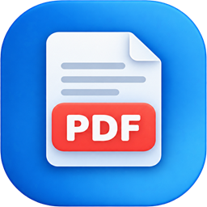

# PDF Manager

A Windows desktop app for everyday PDF jobs: merge, split, extract, reorder and rotate pages, edit metadata, add a watermark, add or remove a password, convert between PDFs and images, and run any of these on many files at once. Everything happens on your computer; files are never uploaded anywhere.

## Features

**Organize**
- **Merge PDF:** combine several PDFs in the order you list them. Each source file becomes a bookmark in the result. Password-protected or damaged files are skipped with a note saying why.
- **Split PDF:** split a PDF into two after a page you type or click on its thumbnail. Writes `<name>_part1.pdf` and `<name>_part2.pdf`.
- **Extract pages:** copy chosen pages into a new PDF.
- **Reorder pages:** drag pages into a new order, or select pages and move them to the start, the end, or one place at a time. Reverse the whole document or reset to the original order. Bookmarks, links, form fields and document properties come along with their pages.

**Edit**
- **Rotate PDF:** rotate all pages or chosen ones by 90° either way or 180°. The thumbnails show the result before you save.
- **Edit metadata:** change the title, author, subject and keywords. Clearing a field removes it. Save as a new file or over the original.
- **Add watermark:** add diagonal or horizontal text at light, medium or strong opacity to all pages or chosen ones, with a live preview.

**Security**
- **Unlock PDF:** remove the password from a PDF you have the password for.
- **Protect PDF:** add a password, with AES-256 encryption.

**Convert**
- **PDF to image:** save pages as PNG or JPEG at 72, 150 or 300 DPI, into a `<name>_images` folder.
- **Image to PDF:** turn JPEG, PNG, BMP, GIF and TIFF images into a PDF with one image per page. Pages can match each image's size or be A4 or Letter, with or without a margin. Photos are turned upright using their orientation tag.

**Batch processing**
- Rotate, watermark, extract pages from, protect or unlock many PDFs, or every PDF in a folder, in one run. Each file shows whether it worked and why not. Save the settings as named presets; passwords are never saved.

**Everywhere**
- Pick pages with lists like `1, 3, 5-7`, or by clicking page thumbnails; the two stay in sync.
- Drag files and folders onto any tool's page.
- Nothing is overwritten without asking, and a failed run leaves existing files untouched.
- Light, dark, or follow the Windows setting.

Settings are kept in `%LOCALAPPDATA%\PDFManager\settings.json`. If something goes wrong, the details go to a log in `%LOCALAPPDATA%\PDFManager\logs`, which the error message points to; nothing is sent over the network.

## Installing

Download the installer for your PC from the [Releases](https://github.com/lifeupnorth/PDFManager/releases) page:

- `PDFManager-<version>-x64-setup.exe` for most Windows PCs (Intel/AMD)
- `PDFManager-<version>-arm64-setup.exe` for Windows on ARM (Snapdragon and similar)

The installer includes everything the app needs (no separate .NET install). It installs for the current user without asking for administrator rights; choose "Install for all users" on the first page to install system-wide. Upgrading is just running a newer installer. Because the installers are not code-signed yet, Windows SmartScreen may warn on first run: choose **More info → Run anyway**.

## Requirements

- Windows 10 version 1809 or later, or Windows 11
- [.NET 9 SDK](https://dotnet.microsoft.com/download) to build

## Build and run

```bash
dotnet build PDFManager.sln
```

```bash
dotnet run --project PDFManager.csproj
```

```bash
dotnet test PDFManager.sln
```

The tests in `PDFManager.Tests` cover the view models through a fake dialog service, and the PDF and rendering code against generated PDFs. The harness in `tools/PDFManager.Harness` drives the real app through its real dialogs; see its [README](tools/PDFManager.Harness/README.md).

## Building the installers

```bash
pwsh installer/build.ps1
```

This publishes the app self-contained for x64 and ARM64 and compiles an [Inno Setup](https://jrsoftware.org/isinfo.php) installer for each into `artifacts/installers`. The Inno Setup compiler is downloaded from NuGet, so nothing needs installing first. Use `-Runtime win-x64` (or `win-arm64`) to build just one. The version comes from `<Version>` in `Directory.Build.props`.

To publish a release, bump that version, commit, and push a matching tag (for example `v1.1.0`): the `release` workflow builds both installers and attaches them to a new GitHub release.

### Code signing

Builds are unsigned until signing is configured; then `build.ps1` signs every executable and DLL the app ships without a valid signature, the installer and its uninstaller (SHA-256, timestamped). That covers the app's own files, iText (which ships unsigned) and the Microsoft NuGet DLLs whose signatures ReadyToRun compilation removes, so Smart App Control has nothing unsigned to block. `signtool` and the signing client are downloaded from NuGet. Configure one of these with environment variables (locally) or in the repository's **Settings → Secrets and variables → Actions** (for the release workflow):

| Method | Settings |
| --- | --- |
| [Azure Artifact Signing](https://learn.microsoft.com/azure/artifact-signing/) (formerly Trusted Signing) | Variables `SIGN_ARTIFACT_ENDPOINT`, `SIGN_ARTIFACT_ACCOUNT`, `SIGN_ARTIFACT_PROFILE`; secrets `AZURE_TENANT_ID`, `AZURE_CLIENT_ID`, `AZURE_CLIENT_SECRET` for a service principal with the *Artifact Signing Certificate Profile Signer* role (locally, `az login` also works) |
| Certificate file (`.pfx`) | `SIGN_CERT_FILE` (or, in CI, the secret `SIGN_CERT_PFX_BASE64`) and `SIGN_CERT_PASSWORD` |
| Certificate in the Windows certificate store | `SIGN_CERT_THUMBPRINT`; also works for USB tokens and cloud-HSM tools that register their certificate there |

`SIGN_TIMESTAMP_URL` overrides the timestamp server. Publicly trusted code-signing keys must now live on a hardware token or cloud HSM, so `.pfx` files are mainly for testing; for CI, Artifact Signing or a CA's cloud-signing service is the practical choice. A build ends with a table showing whether each installer is signed and by whom, and the release notes drop their SmartScreen warning once both installers are signed. Files can also be signed by hand with `installer/sign.ps1 <files>`.

## Project layout

| Path | What's there |
|---|---|
| `MainWindow.xaml` | The window: the sidebar and every tool page, as data templates picked by view-model type. |
| `ViewModels` | One view model per tool, plus `MainViewModel` (navigation) and `SidebarViewModel`. |
| `Services` | The PDF work (`PdfService`, on [iText](https://itextpdf.com/)), page thumbnails and image export (`WindowsPageRenderer`, on Windows.Data.Pdf), dialogs, settings, the error log and crash reporting. |
| `Base` | `ObservableObject` and `RelayCommand`, the small MVVM base. |
| `Themes` | The dark and light colour dictionaries; `ThemeManager` switches between them. |
| `PDFManager.Tests` | xUnit tests. |
| `tools/PDFManager.Harness` | Drives the real exe through a .NET startup hook, for what unit tests can't reach. |
| `installer` | Inno Setup script (`PDFManager.iss`), `build.ps1`, which builds the installers, and the code-signing scripts (`signing.ps1`, `sign.ps1`). |
